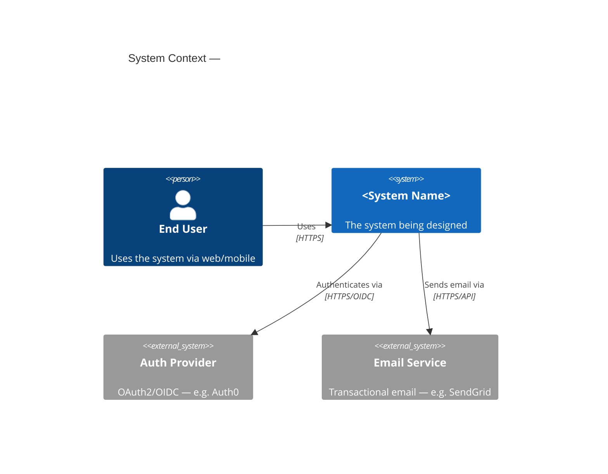

<!--
doc: skill-readme
standard: ste-lite (ASD-STE100 Issue 9 writing rules, no controlled dictionary)
last-refreshed: 2026-10-14
generated-by: doc-refresh skill
-->

# architecture-design

The architecture-design skill designs a new system or a major feature. It starts from
requirements and ends with a saved design document.

## Usage

| Slash command | Mode | What it does |
|---|---|---|
| `/architecture-design` | Full | All ten steps, with C4 diagrams at levels 1, 2, and 3 |
| `/architecture-design --quick` | Quick | For one feature or a small scope. See [Quick mode](#quick-mode). |

Claude asks a short set of scope questions first. If `docs/requirements/` exists, Claude
reads the requirements documents from it.

## Output

The design document contains:

- C4 model diagrams: Context, Container, and Component
- Service and component boundaries
- API contract sketches: REST, GraphQL, gRPC, WebSocket, or event and message
- Data design: entities, relations, a database type per store, PII and encryption flags,
  and a cache strategy
- Failure mode analysis with a mitigation and a recovery time objective (RTO) per path
- Cross-cutting concerns: auth, observability, configuration, deployment, and test strategy
- A "Key Decisions" section and an "Open Questions" section

Claude writes each section when it completes the step. The last step assembles the
sections into the saved file.

## Steps

1. Gather inputs: scope, constraints, scale, timeline, and systems to integrate.
2. Propose an architecture style. Claude explains the tradeoffs and asks you to confirm.
3. Draw the C4 Level 1 System Context diagram.
4. Draw the C4 Level 2 Container diagram.
5. Draw the C4 Level 3 Component diagram for the most complex container.
6. Design the data layer.
7. Sketch the API contracts.
8. Analyze failure modes.
9. Address cross-cutting concerns.
10. Write the design document.

## Quick mode

Quick mode changes the full process in three ways:

- Claude skips step 5 (C4 Level 3).
- The failure mode table is optional. If present, it includes only paths with external
  dependencies.
- Steps 1 and 2 use one confirmation exchange.

## Architecture patterns

| Pattern | Best for | Avoid when |
|---|---|---|
| Monolith (Modular) | Small teams, early stage, unclear domain boundaries | Team larger than 10, independent scaling needed |
| Microservices | Large teams, independent scaling, polyglot stacks | Small team, immature domain model |
| Event-Driven | Async workflows, loose coupling, audit trail | Simple CRUD, low latency required |
| Hexagonal (Ports & Adapters) | Complex domain logic, testability, multiple I/O adapters | Simple CRUD apps |
| CQRS + Event Sourcing | Complex queries, audit history, very different read and write loads | Simple domains, small teams |
| Serverless | Unpredictable traffic, low ops overhead, event-driven work | Long-running jobs, cold-start sensitivity |
| BFF (Backend for Frontend) | Multiple client types with different data needs | One client type |

## C4 model

The skill uses the C4 model (<https://c4model.com/>), a hierarchical notation for software
architecture.

| Level | What it shows |
|---|---|
| L1 Context | The system, its users, and its external dependencies |
| L2 Container | Deployable units: frontends, APIs, workers, databases, brokers, CDN |
| L3 Component | The internal structure of the most complex container |

Diagrams are Mermaid code blocks in the document. If the renderer does not support C4
Mermaid syntax, Claude uses `graph LR` with clear labels.



## Output files

| File | Description |
|---|---|
| `docs/architecture/<name>-design.md` | The full design document with all diagrams and decisions |
| `handoffs/designs/{taskId}_design_{unixTimestamp}.json` | ABD envelope artifact. Claude writes it only if `handoffs/designs/` exists. |

The skill uses the `Read`, `Write`, `Glob`, and `Grep` tools.

## Related skills

- `/adr`: at the end, the skill offers to run `/adr` for the key decisions.
- `/abd-design`: the Design role in the agent-based-development workflow. In an ABD
  project, this skill also writes the handoff artifact.
- `/architecture-review`: run it on an existing codebase before a redesign. It shows what
  must change.

## Installation

Add this repository as a marketplace in `~/.claude/settings.json` (see the root
[README](../../README.md)). Then enable the plugin:

```json
{
  "enabledPlugins": {
    "architecture-design@claude-skills-marketplace": true
  }
}
```
